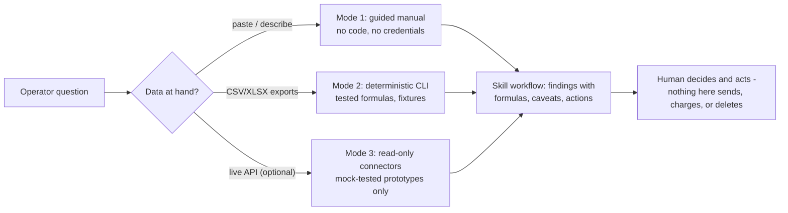

<p align="center">
  
</p>

# OpenCoworking Skills

**Open-source AI agent skills, workflows, data tools, and integrations for
coworking and flexible-workspace operators.**

[](https://github.com/QaliAI/open-coworking-skills/actions/workflows/ci.yml)
[](LICENSE)
[](pyproject.toml)

OpenCoworking Skills turns general-purpose AI agents into practical
coworking operating assistants: tested workflows for sales, occupancy,
revenue, community, operations, marketing, virtual offices, and
workspace-management data — without locking you into one AI model or one
software vendor.

**Bring your own AI. Bring your own systems. Keep control of your data.**

## The problem this solves

Coworking operators already have the data — leads in a CRM, memberships in
a WMS, invoices in accounting — and increasingly have AI assistants. What's
missing is the layer between them: an assistant that knows a private office
contains six workstations, that "occupancy" is three different numbers,
that a canceling office member might stay as a mailbox client, and that a
partner-billed VO client showing "unbilled" may be perfectly fine. Generic
prompts produce polished, operationally wrong answers. These skills encode
the operating knowledge and the arithmetic, with tests.

## Who it's for

Owners and GMs of coworking/flex spaces (1-20 locations), community and
sales managers, the analysts and consultants who serve them, and
developers building coworking integrations. No coding required for the
core value; everything is also scriptable.

## What makes it different

- **Tested, not vibed** — deterministic Python does the arithmetic; both
  demo datasets' expected answers were computed by hand and verified by
  integration tests; 29 known-answer eval cases run in CI.
- **Metric honesty** — every number ships with its numerator, denominator,
  exclusions, and period. Coworking terms aren't standardized and no skill
  pretends otherwise.
- **Vendor-neutral** — a canonical data model with adapters, so the same
  skills work over OfficeRnD, Nexudus, Optix, Archie, HubSpot exports, or
  any CSV. Honest support labels — nothing claims "integration" because a
  vendor has an API.
- **Value before credentials** — every skill works with pasted data
  (Mode 1) or file exports (Mode 2); connected mode is optional, forever.
- **Safety by design** — all skills are read-only or draft-only (R0/R1);
  nothing sends, charges, or deletes; member PII rules and a tested
  redactor are built in; imported data is never treated as instructions.

## Choose your starting point

| You are... | Start with | Then |
|---|---|---|
| **Owner / GM** | "What's our occupancy?" and "Where are we losing money?" on your own exports | The [monthly owner report](.agents/skills/coworking-monthly-owner-report/SKILL.md) and [occupancy forecast](.agents/skills/coworking-occupancy-forecast/SKILL.md) |
| **Community manager** | The [daily brief](.agents/skills/coworking-daily-operator-brief/SKILL.md) (`--role community`) and [member onboarding](.agents/skills/coworking-member-onboarding/SKILL.md) | [Churn risk review](.agents/skills/coworking-churn-risk-review/SKILL.md) before renewal season |
| **Sales manager** | [Pipeline health](.agents/skills/coworking-pipeline-health/SKILL.md) + [speed-to-lead](.agents/skills/coworking-speed-to-lead-auditor/SKILL.md) | Tour prep → follow-up → ghost recovery, in that order |
| **Finance / bookkeeping** | [Collections prioritizer](.agents/skills/coworking-collections-prioritizer/SKILL.md) + [leakage audit](.agents/skills/coworking-revenue-leakage-audit/SKILL.md) | [VO reconciliation](.agents/skills/coworking-virtual-office-reconciliation/SKILL.md) if you have partner-billed clients |
| **Consultant** | The [Coworking Revenue & Operations Health Check](docs/HEALTH_CHECK_SERVICE.md) — one command, one reviewed deliverable. Try it on the [synthetic sample engagement](examples/health-check-engagement/README.md) first | [CRM-WMS reconciliation](.agents/skills/coworking-crm-wms-reconciliation/SKILL.md) — it usually finds the next engagement |
| **Technical user / integrator** | [Technical quickstart](docs/getting-started/technical-quickstart.md), then the [adapter](.agents/skills/coworking-system-adapter-builder/SKILL.md) and [MCP builder](.agents/skills/coworking-mcp-builder/SKILL.md) skills | The [connector prototypes](src/opencoworking/connectors/) (mock-tested; read their status honestly) |

## The three modes, in one picture



A typical path from one skill to a full operator workflow: export
analyzer → data dictionary → occupancy dashboard → leakage audit →
daily brief every morning → owner report every month — each output feeds
the next, and every step works before any of the others exist.

## Five-minute quick start

With Python 3.11+ and git (Windows PowerShell and bash both work):

```bash
git clone https://github.com/QaliAI/open-coworking-skills.git
cd open-coworking-skills
python -m pip install -e .
python -m opencoworking.cli occupancy --inventory examples/synthetic-space/data/inventory.csv --memberships examples/synthetic-space/data/memberships.csv --as-of 2026-07-01
```

You'll get the three-way occupancy dashboard for the bundled fictional
operator — formulas, distortion flags, and all. Then try
`--help`, the [operator quickstart](docs/getting-started/operator-quickstart.md)
(no code at all), or the [technical quickstart](docs/getting-started/technical-quickstart.md).

## Installation into your AI tool

Canonical skills live in [`.agents/skills/`](.agents/skills/) per the
[Agent Skills open standard](https://agentskills.io/specification) — the
directory Codex reads natively and `gh skill install` targets:

```bash
gh skill install QaliAI/open-coworking-skills --all --allow-hidden-dirs
```

Per-host guides (Codex, Claude Code, Copilot, Cursor, Gemini CLI,
OpenCode, Windsurf, Cline, Kiro, Antigravity, manual):
[docs/platform-installation/](docs/platform-installation/README.md).

## Production skills

<!-- catalog:start -->
| Skill | Category | What it does | Modes | Risk | Maturity |
|---|---|---|---|---|---|
| [`coworking-context-builder`](.agents/skills/coworking-context-builder/SKILL.md) | Foundation and governance | Skills re-ask basics and silently assume wrong defaults without a saved operator profile. | manual+export | R1 | stable |
| [`coworking-data-dictionary`](.agents/skills/coworking-data-dictionary/SKILL.md) | Foundation and governance | Silent column mis-mapping (people vs memberships, term vs monthly money) corrupts every downstream analysis. | manual+export | R0 | stable |
| [`coworking-source-verifier`](.agents/skills/coworking-source-verifier/SKILL.md) | Foundation and governance | Reports full of unsourced claims and manufactured causes drive bad pricing and expansion decisions. | manual+export | R0 | stable |
| [`coworking-pii-redactor`](.agents/skills/coworking-pii-redactor/SKILL.md) | Foundation and governance | Sharing raw exports leaks member personal data. | manual+export | R0 | stable |
| [`coworking-wms-export-analyzer`](.agents/skills/coworking-wms-export-analyzer/SKILL.md) | Business intelligence | Metrics run on misidentified or dirty exports produce polished nonsense. | manual+export | R0 | stable |
| [`coworking-occupancy-revenue-dashboard`](.agents/skills/coworking-occupancy-revenue-dashboard/SKILL.md) | Business intelligence | Operators feel 90% full while the bank disagrees - occupancy variants and their distortions are conflated. | manual+export | R0 | stable |
| [`coworking-monthly-owner-report`](.agents/skills/coworking-monthly-owner-report/SKILL.md) | Business intelligence | Owners get raw screenshots or vague prose instead of decision-ready reporting. | manual+export | R1 | stable |
| [`coworking-revenue-leakage-audit`](.agents/skills/coworking-revenue-leakage-audit/SKILL.md) | Business intelligence | Revenue evaporates in gaps between systems - unbilled members, unconverted won deals, idle inventory. | manual+export | R0 | stable |
| [`coworking-pipeline-health`](.agents/skills/coworking-pipeline-health/SKILL.md) | Sales and pipeline | Pipelines die of neglect - stale deals, missing next actions, duplicates, unowned records. | manual+export | R0 | stable |
| [`coworking-speed-to-lead-auditor`](.agents/skills/coworking-speed-to-lead-auditor/SKILL.md) | Sales and pipeline | Teams believe they respond fast; business-hours reality and untouched leads say otherwise. | manual+export | R0 | stable |
| [`coworking-lead-source-normalizer`](.agents/skills/coworking-lead-source-normalizer/SKILL.md) | Sales and pipeline | Channel ROI decisions made on five spellings of the same source are decisions made on typos. | manual+export | R0 | stable |
| [`coworking-lead-to-tour-diagnostic`](.agents/skills/coworking-lead-to-tour-diagnostic/SKILL.md) | Sales and pipeline | Every conversion problem gets misdiagnosed as a marketing-volume problem. | manual+export | R0 | stable |
| [`coworking-tour-preparation`](.agents/skills/coworking-tour-preparation/SKILL.md) | Sales and pipeline | Cold-hosted tours re-ask known questions, show unavailable units, and end without a next step. | manual+export | R1 | stable |
| [`coworking-tour-follow-up`](.agents/skills/coworking-tour-follow-up/SKILL.md) | Sales and pipeline | Generic "checking in" follow-ups transfer all work to the prospect and close poorly. | manual+export | R1 | stable |
| [`coworking-post-tour-ghost-recovery`](.agents/skills/coworking-post-tour-ghost-recovery/SKILL.md) | Sales and pipeline | Ghosted prospects get either abandoned or harassed; both lose the deal and the relationship. | manual+export | R1 | stable |
| [`coworking-member-onboarding`](.agents/skills/coworking-member-onboarding/SKILL.md) | Community and retention | First-60-day churn traces to broken basics nobody owned - access, billing, introductions. | manual+export | R1 | stable |
| [`coworking-churn-risk-review`](.agents/skills/coworking-churn-risk-review/SKILL.md) | Community and retention | Cancellation signals are visible weeks early but opaque scores don't tell a CM who to talk to about what. | manual+export | R0 | stable |
| [`coworking-renewal-preparation`](.agents/skills/coworking-renewal-preparation/SKILL.md) | Community and retention | Auto-invoice renewals lose expansions and trigger price-shock churn. | manual+export | R1 | stable |
| [`coworking-local-seo-audit`](.agents/skills/coworking-local-seo-audit/SKILL.md) | Marketing and local demand | One community homepage cannot match product-by-product local search intent. | manual+export | R0 | stable |
| [`coworking-google-business-profile-audit`](.agents/skills/coworking-google-business-profile-audit/SKILL.md) | Marketing and local demand | The Maps listing is the front door and it rots - wrong categories, stale photos, unanswered reviews. | manual+export | R0 | stable |
| [`coworking-virtual-office-reconciliation`](.agents/skills/coworking-virtual-office-reconciliation/SKILL.md) | Virtual office and mail | Partner-billed VO clients leak silently - unknown clients, unbilled directs, double billing, payout mismatches. | manual+export | R0 | stable |
| [`coworking-cancellation-to-virtual-office`](.agents/skills/coworking-cancellation-to-virtual-office/SKILL.md) | Virtual office and mail | Canceling office members with continuing address/mail needs are lost entirely instead of down-sold respectfully. | manual+export | R1 | stable |
| [`coworking-mcp-builder`](.agents/skills/coworking-mcp-builder/SKILL.md) | Integrations and adapters | Naive MCP servers over member data are PII leaks and billing incidents waiting to happen. | manual | R1 | stable |
| [`coworking-system-adapter-builder`](.agents/skills/coworking-system-adapter-builder/SKILL.md) | Integrations and adapters | Without a disciplined adapter path every new platform request becomes "edit all skills". | manual | R1 | stable |

Plus **22 planned skills** tracked in [`catalog/skills.yaml`](catalog/skills.yaml) and [ROADMAP.md](ROADMAP.md).
<!-- catalog:end -->

## Example operator workflows

- *"How full are we? It feels busy but revenue is meh."* → three occupancy
  numbers, the spread explained by named units
  ([sample output](examples/sample-outputs/occupancy-dashboard.md))
- *"Where are we leaking money?"* → billing gaps, process gaps, and idle
  inventory — deliberately never summed into one fake total
  ([sample output](examples/sample-outputs/leakage-audit.md))
- *"They toured, loved it, and vanished."* → a value-per-touch recovery
  sequence with a stop rule and zero fake urgency
- *"Prep the Eastlake renewal."* → cliff dates, evidence, options, and the
  decisions explicitly reserved for a human

More: [examples/sample-requests/](examples/sample-requests/README.md).

## Sell a coworking health check

The repository ships one command that turns an operator's exports into a
reviewable, print-ready engagement deliverable — the same engine the operator
can run themselves, so there is nothing to lock anyone into:

```bash
opencoworking health-check --input ./client-export --output ./reports/client \
  --client "Client Name" --as-of 2026-07-01
```

It screens the folder first (credentials, database dumps, card and ID data are
refused before analysis), identifies each export from its column signatures,
prints every column rename and every ambiguity it would not guess, runs the
supported diagnostics, and writes a DRAFT report that a human reviews and then
releases with `health-check-finalize`. Every finding is labelled FACT,
CALCULATION, INFERENCE, or RECOMMENDATION with its data, formula, confidence,
and limitation; anything the data cannot answer says NOT MEASURABLE instead of
guessing. Nothing is emailed, uploaded, or sent to anyone by the tool.

The whole path — what the client sends, the command, the review checklist, the
released report, and the follow-on engagements each finding justifies — is
documented in [docs/HEALTH_CHECK_SERVICE.md](docs/HEALTH_CHECK_SERVICE.md), with
a fully synthetic worked example in
[examples/health-check-engagement/](examples/health-check-engagement/README.md).
Client work lives in a git-ignored `engagements/` directory
([convention](engagements/README.md)); exports are never committed.

## Three operating modes

1. **Guided manual** — answer questions, paste tables. No code, no
   credentials.
2. **Export analysis** — CSV/XLSX exports through deterministic, tested
   Python (`opencoworking` CLI).
3. **Connected** — optional future read-only connectors (MCP), never
   required. See honest current status below.

Real before/after outputs from the demo data live in
[examples/sample-outputs/](examples/sample-outputs/) — generated by
running the commands, never hand-written.

## What this cannot do

- **Send, post, charge, modify, or delete anything.** Every skill is
  read-only or draft-only; humans send drafts.
- **Know your market.** No market rates, no industry benchmarks, no
  "spaces like yours" statistics — analyses are of YOUR data only.
- **Predict.** The occupancy "forecast" is contracted arithmetic;
  probabilistic layers require your stated assumptions, attributed.
- **Measure attendance.** Physical utilization needs access-log data no
  current skill consumes.
- **Give legal, tax, or compliance advice.** Ever. The skills flag those
  questions to professionals.
- **Guarantee any host's activation behavior.** Descriptions are
  routing-tested (476/476 with an LLM judge), but hosts differ.
- **Replace judgment.** Merges, prices, saves, and escalations are
  deliberately routed to named humans.

## Supported systems (honest labels)

Any system that exports CSV works today via the
[generic CSV adapter](adapters/generic-csv/README.md).

| System | Status | Meaning |
|---|---|---|
| Anything with CSV export | export-supported | Works now, no credentials |
| HubSpot, OfficeRnD | connector-prototype (**mock-tested**) | Read-only API client code exists, tested ONLY against mocked responses — never against a live or sandbox account |
| Nexudus, Optix, Archie | mapping-documented | Written field-mapping guides; verify against your own export |
| Everything else researched | manual | Paste what you see; checklists apply |

**No system is sandbox- or live-tested.** Label definitions and the full
matrix: [catalog/compatibility.yaml](catalog/compatibility.yaml) and
[docs/research/coworking-systems.md](docs/research/coworking-systems.md).

## Architecture

```text
.agents/skills/     canonical installable skills (Agent Skills standard)
src/opencoworking/  deterministic Python: ingest, normalize, redact, metrics, CLI
schemas/            vendor-neutral data model (JSON Schema)
references/         data model, formulas, terminology (shared domain truth)
adapters/           per-system mapping guides; generic CSV is canonical
examples/           Northstar Coworking Demo + real sample outputs
tests/              unit, integration, hand-computed expected answers
catalog/            machine-readable skill catalog (this README's table is generated from it)
scripts/            validators, eval runner, data generator
docs/               operator guides, installation, security, skill authoring
```

Skill anatomy, quality bar, and how to write one:
[docs/skill-authoring/quality-standard.md](docs/skill-authoring/quality-standard.md)
and the [template](docs/skill-authoring/skill-template.md).

## Data privacy and security

No skill requires credentials for its core value. All shipped skills are
read-only or draft-only. Member data rules, the risk-tier model (R0-R4),
the threat model, and the tested PII redactor:
[SECURITY.md](SECURITY.md) ·
[docs/security/data-handling.md](docs/security/data-handling.md) ·
[docs/guides/protect-member-data.md](docs/guides/protect-member-data.md).
Fixtures are 100% synthetic (enforced by tests).

## Quality and evaluation

Every skill has trigger evals and task evals; every computable output has
command-based known-answer cases against **hand-computed** fixtures on
**two** independent synthetic businesses (149 tests, 29 executed command
evals). A 476-case trigger/collision suite exists, with two executed
LLM-judged routing runs (476/476 on run 2) — see the
[trigger report](docs/evals/trigger-collision-report.md) for exactly what
"executed" means and what remains prepared-only. Maturity is transparent
in the table above: **stable** = complete, tested, and reviewed; **beta**
= complete and engine-tested but not yet operator-proven. Audit trail:
[EXPERT_AUDIT.md](EXPERT_AUDIT.md) ·
[RELEASE_READINESS.md](RELEASE_READINESS.md).

## Troubleshooting (from real clean-install testing)

- **`gh skill install ... ` finds no skills** → add
  `--allow-hidden-dirs` (skills live in the hidden `.agents/` directory;
  verified required on gh 2.92).
- **`UnicodeEncodeError` on Windows consoles** → fixed in current code
  (the CLI forces UTF-8 output); update your copy if you see it.
- **Nonzero exit when piping to `head` / `Select-Object -First`** → the
  downstream command closes the pipe; harmless, and handled in current
  code.
- **`error: field larger than field limit`** → update your copy; fields
  up to 32 MiB now load, larger ones fail with a clear message.
- **Paths with spaces** → quote them; every command is tested against
  spaced paths.
- **`--horizons`/`--as-of` format errors** → dates are `YYYY-MM-DD`;
  horizons are comma-separated integers.

## Try the demo

The [Northstar Coworking Demo](examples/synthetic-space/README.md) is a
fictional two-location operator with 20+ planted problems (ghosted tours,
a double-billed VO client, an expired-but-active membership, a
prompt-injection review...). Point your assistant at it and see what the
skills find — the answer key is in the repo.

## Contributing

Operators who can't code are first-class contributors here — running
skills on your own (redacted) data and reporting where they mislead is
the most valuable review that exists. Developers: adapters are the
highest-value contribution. See [CONTRIBUTING.md](CONTRIBUTING.md),
[GOVERNANCE.md](GOVERNANCE.md), and the
[roadmap](ROADMAP.md).

## License

[Apache-2.0](LICENSE). Third-party notices:
[THIRD_PARTY_NOTICES.md](THIRD_PARTY_NOTICES.md). Source ledger for all
research: [docs/research/SOURCES.yaml](docs/research/SOURCES.yaml).

## Disclaimer

This project provides analysis tooling and drafting assistance, not
legal, tax, financial, or compliance advice. Metric definitions vary
across the industry; outputs state the definitions they use, and you are
responsible for decisions made with them. No ranking, revenue, or
retention outcome is promised anywhere in this repository — anything that
sounds like a guarantee is a bug; please report it.

## Project status

Pre-release (`0.1.0-dev`), independently audited 2026-07-18
([EXPERT_AUDIT.md](EXPERT_AUDIT.md)). 24 stable + 10 beta skills, an
18-command tested CLI, two synthetic businesses with hand-computed
answer keys, and mock-tested connector prototypes. No release tagged, no
remote, no connector live-validated; CI has not yet run on GitHub. The
release gate: [RELEASE_READINESS.md](RELEASE_READINESS.md); what's next:
[ROADMAP.md](ROADMAP.md).
